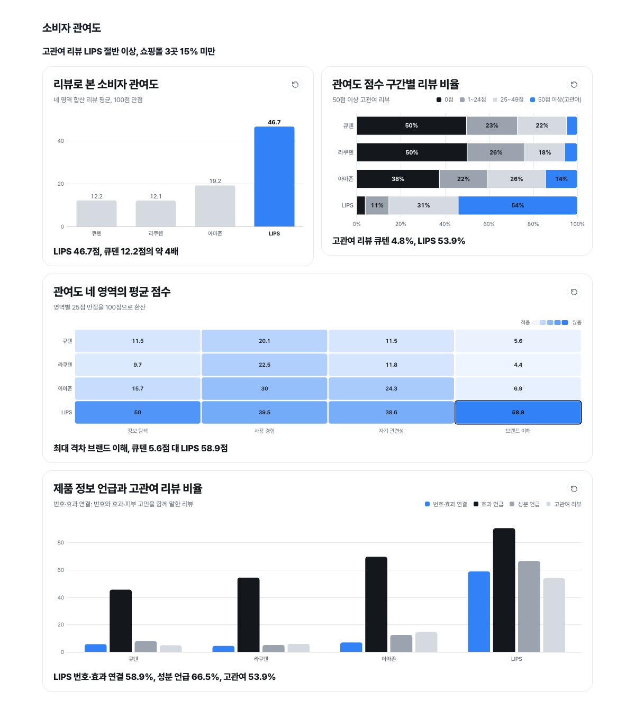
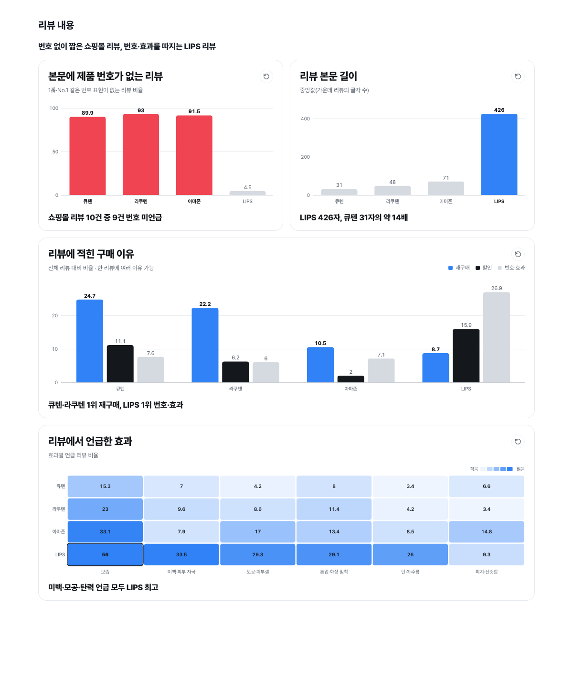

# 넘버즈인 판매 플랫폼별 리뷰 분석

한국 화장품 브랜드 넘버즈인을 일본에서 파는 4개 플랫폼(큐텐·라쿠텐·아마존·LIPS)의 리뷰로 소비자 관여도를 비교한 페이지

| 기간 | 수업 | 결과 | 배포 |
|---|---|---|---|
| 2026.11 | 서울시립대 경영학부 디지털미디어마케팅(2026년 2학기, AI 마케팅 마이크로디그리 이수 과목) 기말 프로젝트 | 진행 중 | https://noru-0731.github.io/numbuzin-jp-review/ |

## 문제의식

- 넘버즈인은 제품 라인을 1번부터 9번까지 번호로 나눠 파는 브랜드
- 마케팅은 번호를 내세우는 데서 끝나고, 번호에서 효능으로 이어 주지 못함
- 판매가 몰린 큐텐 등 쇼핑몰 구매자와, 화장품 후기 앱 LIPS 이용자가 번호와 효능을 어떻게 받아들이는지 확인 필요

## 해결 방법

- 큐텐·라쿠텐·아마존·LIPS에서 2025~2026년 리뷰를 곳마다 500건 무작위 추출
- 리뷰마다 구매 이유, 번호 언급, 언급 효과, 성분·비교·사용 기간·피부 설명·사용법 언급 여부 분류
- 분류 결과로 소비자 관여도 지수(0~100점) 설정
  - 정보 탐색 25점: 성분 언급, 다른 제품과 비교
  - 사용 경험 25점: 사용 기간, 사용법
  - 자기 관련성 25점: 자기 피부 타입·고민 설명
  - 브랜드 이해 25점: 제품 번호와 효과·피부 고민 연결
  - 50점 이상 고관여 리뷰

## 주요 결과

- 리뷰 평균 관여도: 큐텐 12.2점, 라쿠텐 12.1점, 아마존 19.2점, LIPS 46.7점
- 고관여 리뷰: 큐텐 4.8%, LIPS 53.9%
- 본문에 제품 번호가 없는 리뷰: 쇼핑몰 3곳 모두 90% 안팎, LIPS 4.5%
- 번호와 효과를 함께 말한 리뷰: 쇼핑몰 5~7%, LIPS 58.9%
- 구매 이유 1위: 큐텐·라쿠텐 재구매, LIPS 번호·효과
- 글쓴이 연령대: LIPS 20~30대 81.2%, 라쿠텐 40~50대 58.6%

## 페이지 구성

- 소비자 관여도 산정 방식
- 소비자 관여도: 평균, 점수 구간, 네 영역 점수, 제품 정보 언급
- 리뷰 내용: 번호 미언급, 본문 길이, 구매 이유, 언급 효과
- 제품 번호: 리뷰 제품의 번호 구성, LIPS 글이 다룬 번호
- 글쓴이 연령대

## 이전 판

- [판 목록](https://noru-0731.github.io/numbuzin-jp-review/archive/)
- 일본 리뷰 1차 조사(2026.11.18, 11.20 회의용): 큐텐 할인 언급 추이, 제품 라인업, 번호별 효과 일치도 · `archive/meeting-1120.html`

## 만들며 부딪힌 문제

- AI 분류의 '공식 뜻과 일치 여부' 값에 오류(1차 조사)
  - 원인: 일치 여부까지 AI에 맡긴 분류 설계. 표본을 원문과 대조해 발견
  - 해결: AI는 효과만 추출, 일치 여부는 공식 번호 뜻과 규칙으로 다시 집계
- AI가 붙인 인용문 일부가 원문과 글자 불일치(1차 조사)
  - 해결: 원문과 글자 단위로 대조, 맞지 않는 인용문 삭제
- AI가 상품명의 번호를 보고 번호 언급으로 잘못 분류(최종 분석)
  - 원인: 아마존 상품명에 번호가 붙어 있어 본문에 없는 번호까지 언급으로 셈. 본문 번호 낱말과 대조해 275건 발견
  - 해결: 번호 언급은 본문에 번호 낱말이 있는지로 규칙 집계
- 한국에서 접속이 막힌 일본 사이트(@cosme, 야후 쇼핑 등)
  - 해결: 접속 가능한 판매처(라쿠텐, 아마존)로 비교 대상 변경

## 회고

- 해외 사이트 수집이 예상보다 수월: 일본 사이트는 접속 지역과 속도 문제만 해결하면 대체로 수집 가능, 국내 사이트는 막히는 경우가 많아 수집 난이도에 큰 차이
- PDF보다 시각화 HTML: 같은 분석을 HTML 페이지로 공유했을 때 보기 편하다는 반응
- 일상에서 UI 감각 키우기: 과제 밖에서도 HTML로 결과를 만들어 보며 화면을 보는 눈을 키우는 일의 중요성 확인

## 기술

- 마케팅 실무에 필요한 HTML 제작과 영상 편집을 수업 과제에 직접 적용
- HTML 한 장짜리 분석 페이지, React 차트(ztd-charts), GitHub Pages 배포
- AI 도구: 리뷰 수집·집계와 페이지 제작은 Claude Code, 리뷰 2,000건 분류와 문구 검수는 Codex(GPT)

## 자료 출처 · 실행

- 큐텐(Qoo10)·라쿠텐·아마존 재팬 넘버즈인 상품 구매 리뷰
- LIPS 넘버즈인 글
- 넘버즈인 일본 공식몰(numbuzin.jp), BENOW JAPAN 보도자료
- `index.html`을 브라우저로 열기
