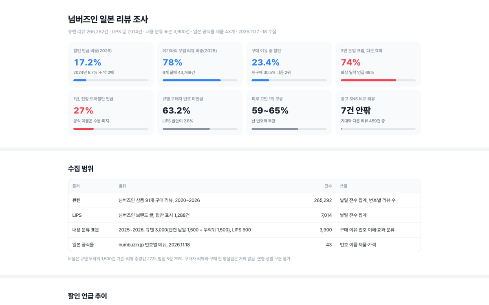
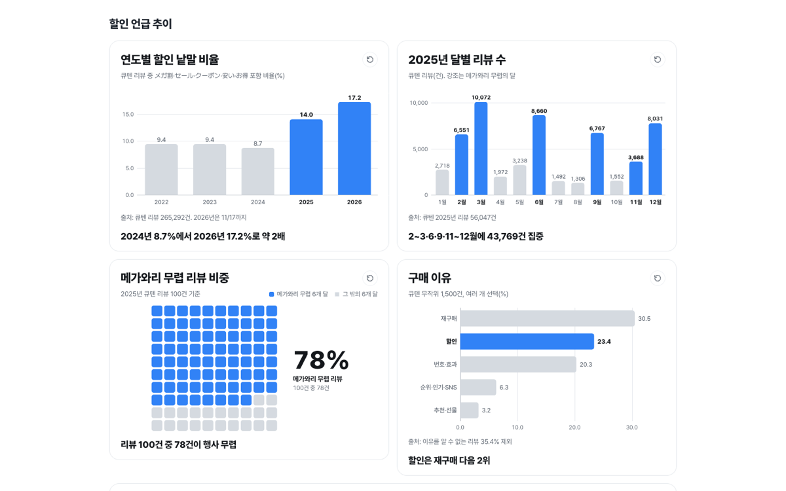
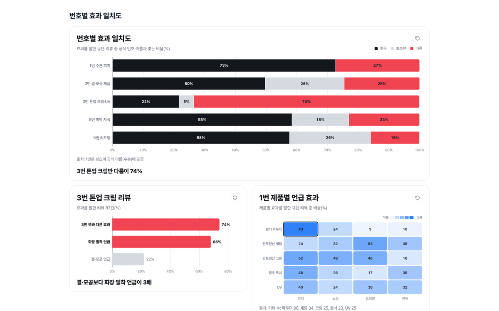

# 넘버즈인 일본 리뷰 조사

한국 화장품 브랜드 넘버즈인이 일본에서 어떻게 사고 쓰이는지를 일본 쇼핑몰 리뷰와 화장품 커뮤니티 글로 조사한 페이지

| 기간 | 수업 | 결과 | 배포 |
|---|---|---|---|
| 2026.11 | 서울시립대 경영학부 디지털미디어마케팅(2026년 2학기, AI 마케팅 마이크로디그리 이수 과목) 기말 프로젝트 | 진행 중 | https://noru-0731.github.io/numbuzin-jp-review/ |

## 문제의식

- 넘버즈인은 제품 라인을 1번부터 9번까지 번호로 나눠 파는 브랜드
- 일본 캠페인 기획 전에 확인할 것: 일본 소비자의 구매 이유, 번호 체계 이해 여부, 번호별 기대 효과와 실제 후기의 일치 여부

## 해결 방법

- 큐텐 구매 리뷰와 LIPS 글을 모아 낱말 전수 집계
- 표본을 뽑아 구매 이유, 번호 이해, 효과 분류
- 일본 공식몰의 번호별 제품 구성과 대조해 공식 이름과 소비자가 말하는 효과가 다른 곳 확인

## 주요 기능

페이지 구성

- 수집 범위: 출처, 기간, 쓰임
- 할인 언급 추이: 큐텐 메가와리 행사와 구매 시점

- 제품 라인업: 번호별 제품군과 리뷰가 많은 제품
- 번호별 효과 일치도: 공식 이름과 리뷰 속 효과 비교

- 번호 언급 방식과 피부 고민
- 광고 비교 리뷰: SNS 광고와 실제 사용을 비교한 후기

## 만들며 부딪힌 문제

- AI 분류의 '공식 뜻과 일치 여부' 값에 오류
  - 원인: 일치 여부까지 AI에 맡긴 분류 설계. 표본을 원문과 대조해 발견
  - 해결: AI는 효과만 추출, 일치 여부는 공식 번호 뜻과 규칙으로 다시 집계
- AI가 붙인 인용문 일부가 원문과 글자 불일치
  - 해결: 원문과 글자 단위로 대조, 맞지 않는 인용문 삭제

## 회고

- 잘된 것: AI 분류를 그대로 쓰지 않고 표본을 원문과 대조
- 잘못된 것: 구매 리뷰는 산 사람의 글이라 사지 않은 사람의 목소리 없음, 짧은 리뷰와 높은 별점 편중
- 다시 한다면: 구매 전 질문 글(Yahoo!知恵袋) 비중 확대

## 기술

- 마케팅 실무에 필요한 HTML 제작과 영상 편집을 수업 과제에 직접 적용
- HTML 한 장짜리 조사 페이지, GitHub Pages 배포
- AI 도구: 리뷰 수집·분류·집계와 페이지 제작을 AI 코딩 도구(Claude Code)로 진행

## 자료 출처 · 실행

- 큐텐(Qoo10) 넘버즈인 상품 구매 리뷰
- LIPS 넘버즈인 브랜드 글
- 넘버즈인 일본 공식몰(numbuzin.jp)
- Yahoo!知恵袋 구매 질문
- `index.html`을 브라우저로 열기
